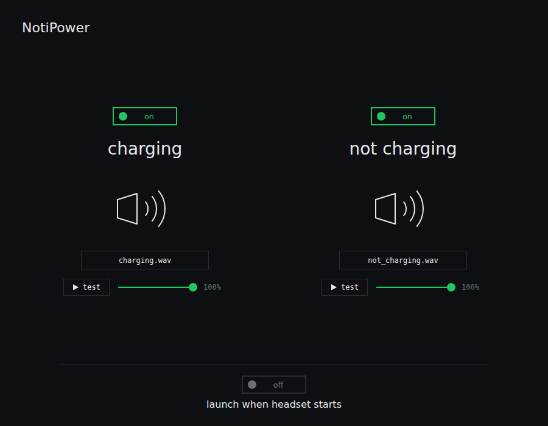

# NotiPower

Plays a sound when your Steam Frame (or any SteamOS / Linux device) is plugged in or unplugged.



- **Plugged in:** one short lip-roll buzz
- **Unplugged:** three lip-rolls, high - low - high (both built in, recorded by hand)
- Each sound has an on/off switch, a **test** button, and its own **volume** slider
- Click the file name under a speaker to pick your own mp3/wav/ogg in the same file dialog Dolphin uses
- **Launch when headset starts** runs it in the background at boot, no window needed
- **Update button:** when a newer version is on this repo, an "Update available :3" button appears top right.
  Click it, then restart the app

## Install (one line)

Open a terminal on the Frame, put your GitHub username in the first word, and run:

```bash
REPO=ShinoSenpaii/notipower; curl -fsSL https://raw.githubusercontent.com/$REPO/main/install.sh | bash -s -- $REPO
```

Then in Steam: **+ → Add a Non-Steam Game → NotiPower**.

## Uninstall

```bash
REPO=ShinoSenpaii/notipower; curl -fsSL https://raw.githubusercontent.com/$REPO/main/uninstall.sh | bash
```

## Requirements

`python3` (standard library only, no tkinter or pip) and PipeWire/PulseAudio (`pw-play` or `paplay`).
The window is a small local web page, so a browser (Firefox or Chromium, e.g. from Discover) is needed to open it.
Sound picking uses KDE's `kdialog` (included with the SteamOS desktop); `zenity` also works, and if neither exists the browser's own file picker is used.
Background mode needs no browser.
For mp3 files, `ffplay`, `mpg123` or `mpv` is needed. The built-in sounds are wav and need nothing extra.

## Files

| File | Purpose |
|---|---|
| `notipower.py` | the app (`--install`, `--background`, or no flag to open the window) |
| `install.sh` / `uninstall.sh` | one-line installer / remover |

Settings live in `~/.config/notipower/`.

## Publishing an update

Edit `notipower.py`, raise the `VERSION = "..."` line near the top (e.g. `1.2.0` -> `1.2.1`), and commit it to `main`.
Anyone who opens NotiPower will then see the update button. Updates are only pulled from this repo.
